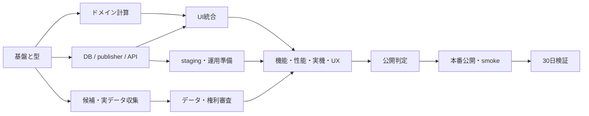

# MVP0実装タスク：写真なし・静的一覧＋外部地図リンク

2026-10-11変更。**下記F-001〜010が現行TODO**。以前のT-001〜040は旧写真/D1/Worker中心構成の履歴であり初期実装には使用しない。

| ID・優先度 | 目的・作業範囲 | 依存 | 完了条件・検証 |
| --- | --- | --- | --- |
| F-001 P0 | React/Vite・Google Maps URLs・Pages Freeの公式条件・ライセンスとバージョン確認 | なし | APIキー/有料契約不要な構成と制限を記録 |
| F-002 P0 | 静的React/Vite/TS strictのlocal雛形、ビルド・型検査・Secret除外 | F-001 | fresh cloneでlocal起動・型検査・buildが実行できる |
| F-003 P0 | SpotLite型・JSON検証・架空fixture・出典管理 | F-002 | 不正座標/不明区分/実データ混入を拒否 |
| F-004 P0 | 現在地・3プリセット、直線距離順、半径/分類/確認済み無料フィルター | F-003 | 権限拒否でも使え、並び・不明区別・320pxを検証 |
| F-005 P0 | Google施設検索・位置ピン・徒歩経路・Street View、Apple代替のリンク生成 | F-003 | URLエンコード/固定先/originなし/誤解決や最寄りパノラマの表示を確認 |
| F-006 P0 | 公式/自治体/現地等から根拠ある先行10スポットを収集 | F-001,F-003 | 正確な座標・利用条件・確認日・ライセンス。写真・無断転載・架空0件 |
| F-007 P0 | 一覧画面・エラー/空・アクセシビリティと全リンクを統合 | F-004,F-005,F-006 | PC/iOS/Androidの検索→外部地図、キーボード、通信失敗を検証 |
| F-008 P0 | Cloudflare Pages Freeの実残量・権限・公開承認確認後の静的デプロイ | F-007 | 実URLでリンク・データ・出典を再確認。自動課金なし |
| F-009 P1 | 実地確認スポットを段階拡充 | F-006 | 目標は実データ実績で調整。無根拠の設備・料金を埋めない |
| F-010 P1 | 一覧UXを測定し必要ならLeaflet＋地理院の内蔵地図を別タスク設計 | F-007 | 有効な改善根拠と費用・ライセンスを確認 |

実装順：F-001→F-002→F-003→F-004/F-005/F-006並行→F-007→公開承認→F-008。追加F-009/F-010は後続。仕様：[docs/FREE_MVP_STRATEGY.md](docs/FREE_MVP_STRATEGY.md)。アプリ本体・試験・公開はいずれも未実施。

---

## 旧T-001〜T-040：履歴・非アクティブ

# LeSpot 実装タスク v1.0

2026-10-11：設計作業の成果として作成。**以下40タスクはすべてTODO。アプリの実装・試験・公開は未着手。** 優先度P0はパイロット公開に必要、P1は公開後検証。設計文書のCommit完了を実装タスクの完了へ流用しない。

## 1. 実行規則

依存タスクの完了条件と必要な承認ゲートを満たしてから着手する。同じファイル・DB・公開refへの競合する書込を並列実行しない。可逆なlocal作業は暫定設計で進められるが、課金・外部公開・実データ公開はDECISIONSの該当ゲートを満たすこと。

タスク完了には作業範囲、実際の検証、Commitを残す。未実行検証をPASSにしない。仕様変更は先に該当正本と決定ログへ記録する。以下のコマンドや実装パスは予定であり、現在存在するものではない。

## 2. マイルストーンと順序

| 段階 | 到達点 | 主なタスク |
| --- | --- | --- |
| M1 | ローカル基盤・型・fixtureが再現可能 | T-001〜005 |
| M2 | ドメイン計算、データ公開、read APIが検証可能 | T-006〜017 |
| M3 | 検索→詳細→外部経路のUIが完結 | T-018〜025 |
| M4 | 審査済み初期データと安全なstaging | T-026〜030 |
| M5 | 性能・実機・権利・運用・UXの公開判定完了 | T-031〜038 |
| M6 | 承認済み本番公開・直後の動作確認 | T-039 |
| M7 | 30日パイロット検証・次期判断 | T-040 |

ボトルネック候補は時間/価格の判定、公開器の整合性、実施設の権利・情報確認、実機UX。ドメイン計算、UI mock、データ候補収集は共有型確定後に独立して進められる。上位表の連番順だけでなく下表の依存関係を優先する。

## 3. M1：基盤

| ID / 状態 / 優先度 | 目的・具体的作業範囲 | 依存 | 完了条件 | テスト・検証 |
| --- | --- | --- | --- | --- |
| T-001 / TODO / P0 | 実装基準を固定。AGENTS・DECISIONS確認、Svelte/SvelteKit/adapter/Node/pnpm/テスト基盤の公式安定版と互換性、O-01〜05の必要時点を整理 | なし | バージョン選定・互換根拠・承認状態を記録。未承認を承認済みにしない。課金・外部公開なし | 公式リリースとadapter手順の照合、必要なバージョン範囲の矛盾確認 |
| T-002 / TODO / P0 | 最小SvelteKit/TypeScript strict基盤、Cloudflare adapter、lockfile、local設定、secret除外、binding型生成、空の確認ページ | T-001 | fresh cloneから依存導入・local起動・build。実スポット・認証・検索UIはまだ作らない | Windowsを含む手順確認。SSRでwindow参照なし、bundleに秘密なし |
| T-003 / TODO / P0 | format/lint/typecheck/unit/buildとGitHub CIを定義。最小permissions、secret scan、依存監査、失敗時停止 | T-002 | READMEの実コマンドで同じ検査が実行でき、失敗を検出する。remote deployは自動化しない | 意図的な型・lint・単体失敗がCIを失敗させること |
| T-004 / TODO / P0 | DATA_MODEL/APIの共有schema・enum・authoring型・公開allowlist型を作成。NULL、長さ、unknown補完を定義 | T-002 | 全フィールド・13設備・17カテゴリ・UTC/日付/座標が正本と対応。public/privateを分離 | TS-19/24/25のschema部分、境界値・未知キー拒否 |
| T-005 / TODO / P0 | 代表fixture・500件fixture、固定時計・位置・祝日・公開版を用意。fixture生成を再現可能にする | T-004 | 全代表状態を含み、is_fixtureと架空名称が付く。生成seed・件数・size固定 | 生成再現、schema全件検証、production混入拒否の失敗fixture |

## 4. M2：ドメインとデータ層

| ID / 状態 / 優先度 | 目的・具体的作業範囲 | 依存 | 完了条件 | テスト・検証 |
| --- | --- | --- | --- | --- |
| T-006 / TODO / P0 | Haversine、距離表示、安定sort、地域bbox交差・重複排除・最大取得数を実装 | T-005 | 距離・地域選択を純粋関数で再利用できる。GPS通信なし | TS-04/05、境界・同距離ID・座標逆転・国内範囲外 |
| T-007 / TODO / P0 | checksの鮮度、conditional、設備・屋内外・quietnessの厳密一致を実装 | T-005 | unknown/stale/disputedの誤肯定なし。条件付き表示理由を返せる | TS-06/07、期限ちょうど、missing check、ソファと仮眠許可の分離 |
| T-008 / TODO / P0 | 最低必須料金・適格プラン・有効日・無料判定・予算比較を実装 | T-007 | 税込一般料金・必須費用・条件付き/動的価格を区別。総滞在額を捏造しない | TS-08/09、0/NULL/会員/登録料/期限失効 |
| T-009 / TODO / P0 | 日またぎ、祝日coverage、暦日例外、現在営業・連続滞在・深夜・本日24hを実装 | T-005,T-007 | 時刻とtimezoneを注入でき、優先順位・半開区間が正本どおり | TS-10〜14、時計ずれ判定の単体試験 |
| T-010 / TODO / P0 | 全フィルターと結果件数・安定順の検索coreを統合。時間条件と費用を別判定 | T-006,T-008,T-009 | 項目間AND、座席等のORが一定。条件評価順を変えても集合が不変 | TS-06〜14、500件で単体性能の基準値を採取 |
| T-011 / TODO / P0 | D1の版管理・正規化テーブル・index・制約・migrationをlocalに作成 | T-004 | 空DBから構築でき、同版FKと未公開release隔離、payload上限を検査 | FK・unique・enum・migration再適用、TS-24/27 |
| T-012 / TODO / P0 | 写真の検査・権利metadata・再エンコード・EXIF除去・hash・private保管を実装 | T-004 | 指定寸法/byte内のWebP生成、原本非公開、再実行可能、backup確認 | TS-22/25、偽装/巨大画像/人物処理の運用確認。まずlocal |
| T-013 / TODO / P0 | authoring CLIのvalidate/plan、根拠・矛盾・公開用projection・書込予算レポートを実装 | T-005,T-011 | 読取のみのplanでsource SHA/revision/対象環境/差分を表示。致命的エラーを拒否 | TS-24/27/30、公開allowlistのsnapshot、架空データ排除 |
| T-014 / TODO / P0 | publisherのstaging登録、params分割、R2先行、read-back、ready、CAS切替、冪等性を実装 | T-012,T-013 | 不完全版が公開されず、競合時停止。localで完結、remoteはT-029後に再検証 | TS-26/27、全工程の失敗注入、timeout後の現revision照合 |
| T-015 / TODO / P0 | takedowns台帳、非公開化、保持版GC方針、安全なrollbackコマンドを実装 | T-014 | 旧版でも最新取り下げを守る。不適格版への直切替を拒否し安全版を作れる | TS-28、画像権利撤回→rollback、並行更新、active版誤削除拒否 |
| T-016 / TODO / P0 | manifest/地域dataset/healthの公開read API、headers、ETag、revision整合を実装 | T-011,T-014 | API仕様準拠。アクティブ版の公開候補だけ取得。巨大JSONの毎回全JOINを避ける | TS-19、schema照合・HEAD/304/409/400/405/503 |
| T-017 / TODO / P0 | 詳細read APIとSSR取得、状態別404/410、画像配信の権利検証を実装 | T-012,T-016 | 非公開本文・原本・R2キー・private証拠を露出しない。休業と取り下げを区別 | TS-20/22、古い画像URL/任意path/secret除外/SSR |

## 5. M3：利用者向けUI

| ID / 状態 / 優先度 | 目的・具体的作業範囲 | 依存 | 完了条件 | テスト・検証 |
| --- | --- | --- | --- | --- |
| T-018 / TODO / P0 | data-client、地域並列取得、abort、メモリcache、60秒再検証、時計・offline状態を実装 | T-016 | 版を混在させず部分失敗を表現。GPS・データを永続storageへ書かない | TS-05/17/18、遅延応答・世代競合・visibility復帰 |
| T-019 / TODO / P0 | 明示geo取得、精度注意、拒否・timeout代替、presetとメモリ中心状態を実装 | T-002,T-005 | 自動prompt/連続追跡なし。拒否後も検索可。共有URLに座標なし | TS-01〜03、実機再試験はT-033 |
| T-020 / TODO / P0 | Leaflet遅延import、地理院pale/std、出典、pan後検索、ピン集約・選択・cleanup | T-002,T-005 | SSR安全、出典を隠さない、map adapterで交換可能、一覧代替へ退避可 | TS-21、map mock、同位置ピン、再mount、通信先allowlist |
| T-021 / TODO / P0 | レスポンシブ地図/一覧、距離順カード、20件追加、検索中心・選択ID同期 | T-010,T-018,T-020 | モバイルtab/PC2列、同一結果を描画、中心基準・部分結果のラベル表示 | TS-04/16/21、キーボード主要導線の初期試験 |
| T-022 / TODO / P0 | 全検索条件UI、draft/applied、条件chip、URLの非機微条件、0件回復を実装 | T-021 | 要件の全フィルターが指定可能。自動緩和なし、条件付き・料金・深夜日付の説明 | TS-06〜16、戻る/Escape/reset/未知query |
| T-023 / TODO / P0 | 詳細、確認日時、設備4値、料金条件、写真dialog、外部経路URLを実装 | T-017,T-019,T-021 | URL直開き・戻る・写真なし・状態変更に対応。originなしの歩行リンク | TS-03/20/22/23、alt/credit/見出し/最終確認と更新日の分離 |
| T-024 / TODO / P0 | 全loading/空/未対応/失敗/期限切れ状態、focus復帰、aria-live、motion配慮を統合 | T-022,T-023 | 状態ごとに次の操作があり、読込失敗を不存在扱いしない。操作不能なし | TS-02/15〜22/32、自動a11yと通信失敗注入 |
| T-025 / TODO / P0 | about/privacy/terms/credits、位置・外部送信・情報の限界・連絡先を実装 | T-002 | 公式出典と運営者設定に基づく本文。連絡先未定は公開ゲートで停止 | TS-35、リンク検査、文面レビュー、出典表示 |

## 6. M4：実データと環境

| ID / 状態 / 優先度 | 目的・具体的作業範囲 | 依存 | 完了条件 | テスト・検証 |
| --- | --- | --- | --- | --- |
| T-026 / TODO / P0 | 公式候補収集、地域bbox/3preset座標、施設内区画単位、取得条件を整理 | T-004 | 出典付き候補一覧と確認済み基準点。未確認設備を補完しない | SRC-15等の実CSV/利用条件確認、座標・重複・coverage審査 |
| T-027 / TODO / P0 | 先行10件を現地/公式で登録し、撮影許可・写真処理・入力工数を検証 | T-012,T-026 | 10件の根拠・区画・権利の確認票。未確認はunknown。実績から収集計画補正 | TS-24/35、schema/現地照合、写真許可とクレジット |
| T-028 / TODO / P0 | 初期60件へ拡充し、無料/屋内/写真/750m coverageの目標を満たす | T-027 | REQUIREMENTSのデータ基準を満たすか、不足と承認済み目標変更を記録。捏造なし | 件数unique集計、期限・条件・写真・全地域coverage検査 |
| T-029 / TODO / P0 | 契約残枠・予算・権限確認後、分離staging/production設定と秘密管理、staging認証を用意 | T-003 | O-02/O-03の必要承認記録、誤環境書込防止、非公開preview。無承認課金なし | TS-30、認証なしアクセス拒否、対象ID/権限/secret確認 |
| T-030 / TODO / P0 | CSP/security headers、入力/SQL/XSS/URL、GPS/secret非送信、依存脆弱性を監査 | T-017,T-024,T-025 | 重大欠陥0、例外理由記録、公開bundle/log/network検査済み | TS-03/19/20/25/30、攻撃入力とbrowser network検証 |

## 7. M5〜M7：品質・公開・検証

| ID / 状態 / 優先度 | 目的・具体的作業範囲 | 依存 | 完了条件 | テスト・検証 |
| --- | --- | --- | --- | --- |
| T-031 / TODO / P0 | stagingで検索→詳細→経路、API/publisher、各失敗状態の統合E2E | T-015,T-024,T-029,T-030 | FR全体の自動可能部分がPASS。型・DB・SSR・画面の整合、結果証跡あり | TS-01〜30の対象部分、旧版/新版本番相当cache確認 |
| T-032 / TODO / P0 | 500件、4G相当、実API/CPU/DB/画像の性能と費用を実測・改善 | T-010,T-021,T-029,T-030 | NFR-01〜03とFree CPU可否の記録。未達は対策か承認待ちとして明示 | TS-31、raw/gzip上限、p95、料金モデルの実測更新 |
| T-033 / TODO / P0 | PC/スマートフォン実機・前主要版、キーボード/読上げ/拡大、現地地図UXを確認 | T-024,T-029 | 対象端末記録、重大操作障害0。地理院背景の適否と必要代替を判断 | TS-32/33、iOS地下位置拒否、屋外判読、Windows操作 |
| T-034 / TODO / P0 | 監視workflow、通知、費用50/70/90%運用、週次点検を設定・検証 | T-016,T-029 | GitHub Actions契約と使用量確認、監視失敗通知到達、担当・手順が確定 | TS-34、意図的failure、最長実行時間と月使用量試算 |
| T-035 / TODO / P0 | 空DB/画像backupから復元、app/data rollback、取り下げ維持、障害対応演習 | T-015,T-029 | 復元hash一致、公開済みデータ欠損なし、2時間目標と実測、手順修正 | TS-28〜30/34、失敗注入・権利撤回後の復旧 |
| T-036 / TODO / P0 | 実データ公開候補の最終確認、期限・権利・写真・coverage・連絡先を審査しstagingへ公開 | T-014,T-028,T-035 | 初期データ基準・approved写真・最新根拠、公開版read-backと審査記録 | TS-24/27/28/35、実施設と表示内容の抜取現地照合 |
| T-037 / TODO / P0 | 同意済み5名×3課題で検索時間・成功・条件理解を評価し阻害要因を修正 | T-033,T-036 | TS-36前半の基準を満たすか、具体的未達・改善・例外承認を記録 | 15試行の匿名集計、中央値、支援有無、4/5条件理解 |
| T-038 / TODO / P0 | 公開判定レビュー。全FR/NFR証跡、予算/連絡先/rights/運用/残課題を統合 | T-025,T-031,T-032,T-034,T-035,T-036,T-037 | オーナーの公開判断を記録。重大欠陥・権利/秘密/fixture問題0、未確認事項の無断免除なし | TEST_PLAN公開ゲート、要件トレース全行、承認記録 |
| T-039 / TODO / P0 | 承認済みproductionへアプリと審査済みデータを公開し直後smoke、rollback準備 | T-038 | 実URLで検索/詳細/写真/出典/外部経路/連絡先/geo拒否を確認。Git/Worker/data版記録 | 公開URLから再取得、PC+iOS/Android主要導線、監視と60秒取り下げ確認 |
| T-040 / TODO / P1 | 公開後30日パイロットの誤情報・工数・費用・利用者課題を評価し次期範囲を決める | T-039 | 20件再点検、誤肯定数・原因、実運用費と工数、継続/修正判断。自動追跡を無断追加しない | TS-36後半、匿名集計・根拠記録・次期タスク提案 |

## 8. 将来機能（MVPの完了条件に含めない）

投稿・写真投稿、口コミ、お気に入り、混雑、アプリ内情報修正依頼、専用管理UIは別エピックとして要件化する。ユーザー認証、モデレーション、画像アップロード、個人情報・利用規約・費用を再設計してから着手する。未使用のusers/reviews等を先行作成しない。

## 9. 次のWork Unit

次回の実装依頼後は `NEXT_WORK.md` のWU-01から開始する。タスク状態変更時は実行日時・担当・Commit・検証記録へのリンクをこの文書に追記し、進行中の最小作業を `AI_WORK_STATE.md` に記録する。
