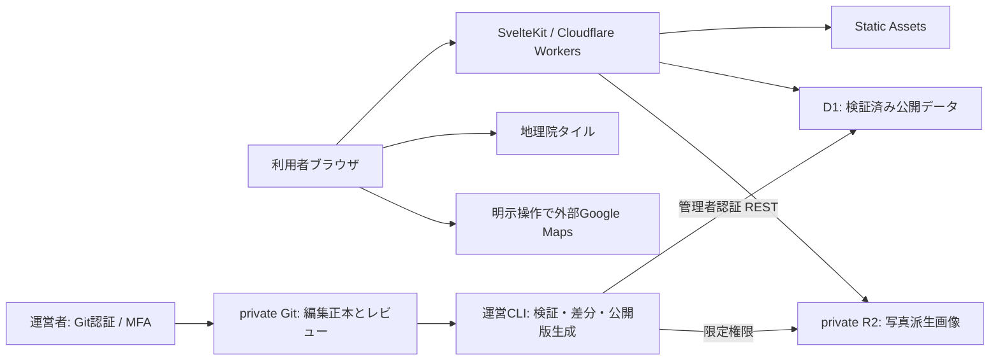

# LeSpot 基本設計 v1.0

ステータス：`PROPOSED_DEFAULT`。以下は実装可能な推奨基準であり、ユーザーによる技術選定の承認記録ではない。要件は `REQUIREMENTS.md`、根拠・価格は `RESEARCH_AND_COSTS.md`。

## 1. 選定結果

| 層 | 推奨 | 理由 |
| --- | --- | --- |
| UI・HTTP | Svelte / SvelteKit + TypeScript strict | 画面と小規模read APIを1プロジェクトで管理。詳細のSSRとクライアント検索を分けられる |
| 地図 | Leaflet + 国土地理院の淡色地図（標準地図へ明示切替可） | 日本語背景地図と独自休憩スポットを分離。必須の地図API課金・キーをなくす |
| 実行 | Cloudflare Workers + Static Assets、公式Cloudflare adapter | 自前サーバーの常時運転不要。静的資産とAPIを同一オリジンで配信 |
| 公開DB | Cloudflare D1 | 地域別の公開データ配信、版管理、参照整合性を小規模運用で実現 |
| 写真 | private R2 Standard、Worker経由 | 権利確認済み派生画像のみを公開。任意バケットURLの公開を避けて取り下げ可能にする |
| 編集正本 | private Repository内の構造化JSON + 運営CLI | 変更履歴・レビューを活用し、MVPで専用管理画面や公開書き込みAPIを作らない |
| 検証 | Vitest、Testing Library、Playwright、axe-core | 純粋関数、HTTP、ユーザー操作、自動a11yを分担。実機確認は別途必要 |

バージョンは実装WUで公式安定版・相互互換性を確認してlockする。SvelteKit v2/v3等でCloudflareのbinding取得方法が異なるため、`bindings.server.ts` に封じ込める。古いサンプルから `platform.env` 等を無条件にコピーしない。

## 2. 全体構成

ユーザーの緯度経度をLeSpotの検索APIへ送らない。公開地域データを取得し、距離・条件検索はブラウザ内で行う。地図タイル配信先にはIPと表示タイル範囲が伝わり得る。完全な位置秘匿を保証する設計ではない。

## 3. コンポーネント責務

- `UI`：画面・フォーカス・URLの非機微条件・一覧とピンの同期。ドメイン判定を重複実装しない。
- `domain`：距離、条件一致、料金適格性、営業時間、信頼性・期限判定。DB、Svelte、Leafletをimportしない。
- `data-client`：公開地域の選択、ETag、部分失敗、版の不一致、AbortController、メモリキャッシュ。
- `map-adapter`：タイル設定、ピン、選択、中心移動、出典、破棄。タイルを勝手に収集・保存しない。
- `server repository`：公開版だけの取得と安全なDTO配信。施設情報をリクエストごとに外部サイトへ問い合わせない。
- `publisher CLI`：authoring JSONの検証・リリース生成・管理者認証による登録・参照先の切替。ブラウザ利用者には提供しない。

SvelteKitの詳細ページはサーバー側で現在の公開詳細DTOを読む。ブラウザの現在地はクライアント取得のみ。地図ライブラリはブラウザで遅延importし、SSR時にwindowへアクセスしない。JavaScript無効時は説明・地域別一覧・詳細を提供し、対話検索にはJavaScriptが必要と表示する。

## 4. データの正本と公開版

編集正本はGitのauthoring JSONのみ。D1は検証済み派生データで、管理画面やD1 Consoleから通常編集しない。D1上の正規化テーブルと検索用payloadは同じリリースから生成される読み取りモデルであり、独立した編集正本ではない。

各公開版には `release_id`、元Git SHA、schema_version、checksumを持たせる。正規化行・地域payload・詳細payloadはrelease単位で隔離し、全件検証後に `publication.active_release_id` を1つの条件付きUPDATEで切り替える。途中まで登録した版を配信しない。公開APIに過去release指定機能を作らない。

R2とD1は分散トランザクションにしない。写真を先に置く → 存在・サイズ・ハッシュ確認 → データ版を準備 → 公開ポインター切替。途中失敗の未参照画像は後日GCできる。R2オブジェクトがあるだけでは公開できない。

## 5. 検索方式

地域manifestのbboxと検索円のbboxの交差で取得対象地域を選ぶ。各スポットには所属地域を持たせ、境界をまたぐ取得はIDで重複排除する。取得済みの同じ版のデータに対し、距離・カテゴリ・設備・営業等を適用する。

初期は1地域・約60件を想定。1地域500件または未圧縮1,500,000 bytes・gzip350KBのいずれかを超える前に分割する。上限超過を黙って切り捨てない。初期実装の同時取得上限は8地域、超過時は「範囲を狭めてください」。地域境界と件数上限は設定で管理する。

地図パンだけで取得・距離基準を変えず、「この周辺で探す」で検索中心を更新する。ユーザー現在地と地図中心は別の状態。順序は未丸めの直線距離→スポットID。距離、時間、料金の具体規則は詳細設計へ委譲する。

## 6. 代替案の比較

| 選択 | 利点 | 欠点・今回の扱い |
| --- | --- | --- |
| 静的JSONのみ | DB・管理API不要、最小構成 | データ更新とアプリ配信が結び付き、即時取り下げ・原子的な複数地域更新が扱いにくい。料金契約を避ける必要がある場合の代替 |
| D1 + public payload | 読取コストを抑え、公開版を独立管理 | 地理検索専用DBではない。地域分割、版管理CLIが必要。今回の推奨 |
| Supabase/PostgreSQL + PostGIS | 多地域・空間検索・認証・管理UIを育てやすい | 初期の閲覧中心サービスには運用面・費用面で機能過多。ユーザー投稿や広域検索時に再評価 |
| 自前PostgreSQL/VPS | 自由度が高い | OS保守・バックアップ・障害対応が増える。MVPでは不採用 |
| Google Maps + Places | 施設情報・商業地図を統合しやすい | 課金単位と取得情報の保存・表示制約が独自DBと相性を持つ。利用条件を満たす別構成としてのみ検討 |
| MapLibre + 商用タイル | ベクター描画・視認性の自由度 | 契約、キー、料金・表示条件の確認が必要。地理院地図がUX試験に通らない場合の有力代替 |

公式サポートが確認できることと、LeSpot上で互換性・性能を試験済みであることは異なる。後者は未実施。

## 7. 非機能設計

公開HTTPはGET/HEADだけ。閲覧アカウント・セッションCookieは作らない。公開DTOはallowlist生成し、未公開施設、内部メモ、証拠保管先、管理者情報、R2内部キーを含めない。

データレスポンスは短いキャッシュ期限とETagを利用する。写真も公開可否を確認して配信する。署名URLで原本を公開する設計にはしない。詳細は `API.md` と `OPERATIONS.md`。

不明データ・画像失敗・地図停止が他機能の利用を止めないようにする。ただしD1データが初回から取得できない場合、実在施設を架空のデモで置き換えない。エラーと再試行を表示する。

## 8. 将来拡張と移行条件

全国拡張で地域取得数・payloadサイズ・検索時間が継続的に上限を超えた場合は、bbox索引またはPostGISのサーバー検索を検討する。その際、現在地の外部送信とログ・プライバシー方針を再承認する。

投稿導入時はユーザー認証、投稿状態、モデレーション、スパム対策、画像アップロード検証、削除権限を追加する。管理UI導入時はGit編集とDB直接編集を併存させず、どちらを正本にするか移行計画を決める。お気に入り等のテーブルを未使用のままMVPへ作らない。

地図プロバイダーを変更しても独自スポットの権利・データは独立する。地理院背景の画面を根拠に無断で他社POIを追加しない。
