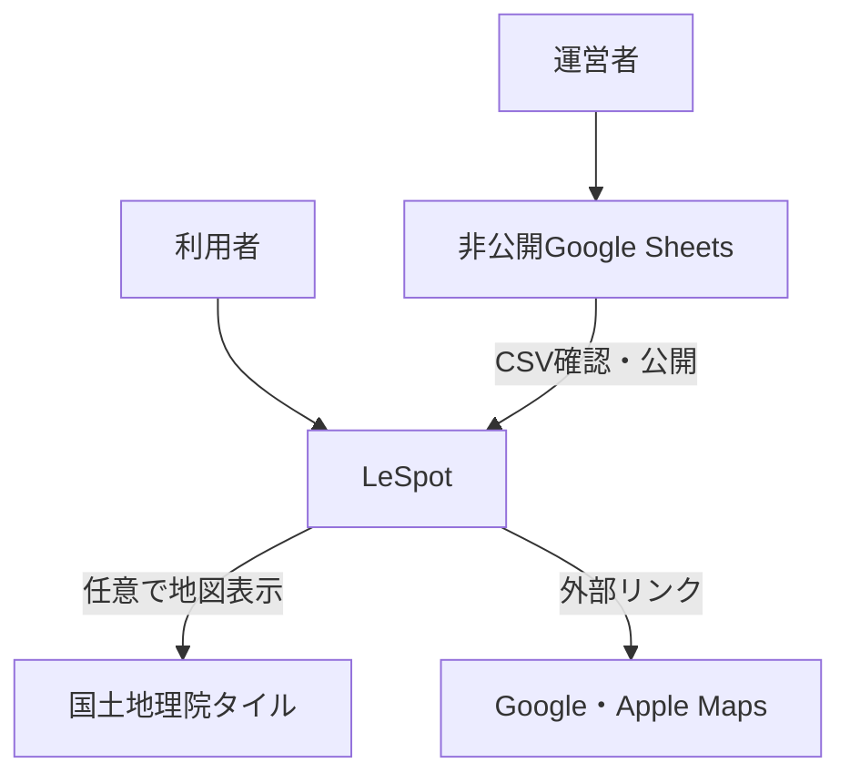
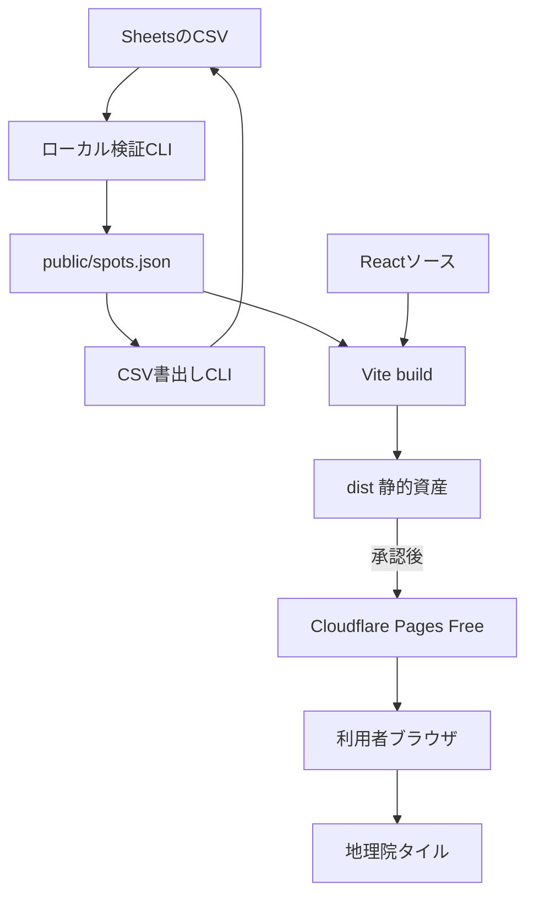
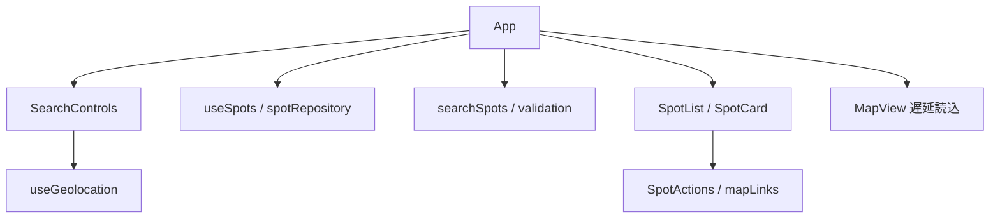
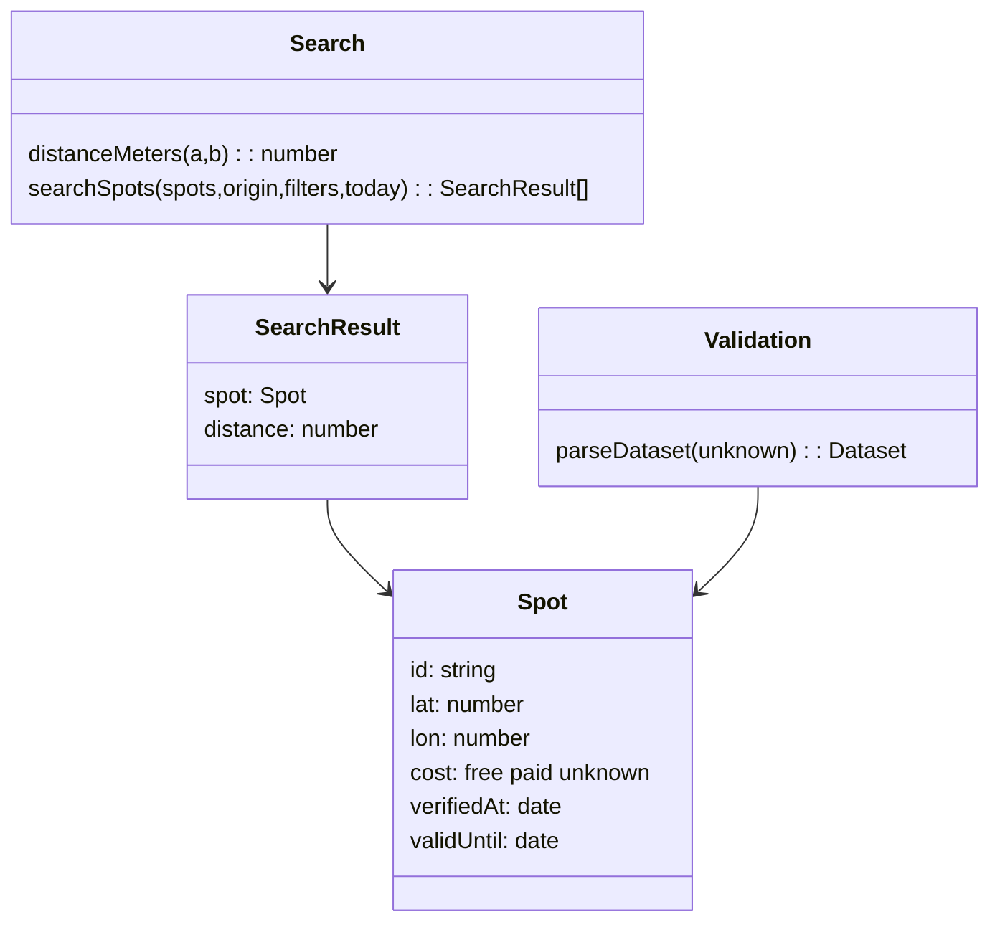

# C4アーキテクチャ v2

## C1: Context

外部サービスには写真・口コミを取りに行かない。タイル表示時にIPと表示範囲が伝わる。

## C2: Containers

Sheetsとの認証接続は未実施。ブラウザはSheetsを直接参照しない。DB/バックエンドは存在しない。Pagesは候補であり未接続。

import/exportは同じ列定義・検証スキーマを使用する。公開JSONの初期2件はDATA_EVIDENCEに根拠を記録。

## C3: SPA components

選択ID・基準座標・フィルターはApp内。ドメイン処理はReactに依存しない。MapViewだけがLeafletに依存し、検索条件変更では地図インスタンスを再生成しない。

## C4: Code

本番配信の条件はOPERATIONS、費用比較はRESEARCH_AND_COSTS。旧Worker/D1/R2/一覧だけのMVPは置換済み。
