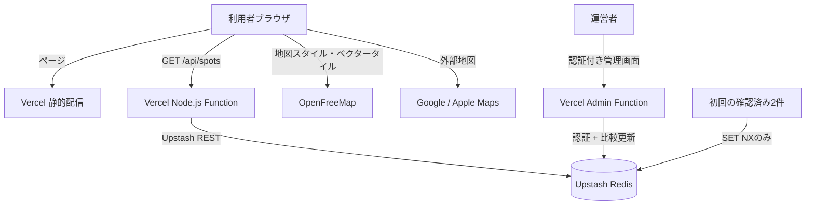

# LeSpot アーキテクチャ v3

## 構成

### 公開処理

`src/data/spotRepository.ts` → `GET /api/spots` →
`server/database.ts` → Upstash Redis → Zodで検証したJSON。

CSVからのデプロイ時生成や`public/spots.json`は廃止しました。
DBが空の場合だけ、`data/bootstrap-spots.json`を初期登録します。
既存DBは上書きされません。DB障害時はHTTP 503を返します。

### 編集処理

`/admin.html` → `src/admin/Admin.tsx` →
`/api/admin/spots` → Bearer認証・Origin検査・Zod検証 →
Redis上の楽観的比較更新（Lua EVAL）。
保存に成功するとrevisionを増やして配信します。

### 地図と検索

`src/app/App.tsx`が検索条件と選択中のスポットを保持し、
MapLibre GL JSの`MapView`に渡します。OpenFreeMap Positronスタイルを読み込み、
`roadOnlyMapStyle`で背景と道路レイヤー以外を描画前に除外します。
APIキー・アカウントは不要で、タイルリクエストはブラウザから直接送信します。
初回表示から地図が主役です。
PCは一覧＋地図、スマホは地図＋検索/結果シートです。
GPSは許可制で、DBに送信しません。

### ファイルストレージ

Vercel Blobは接続済みですが、画像等の必要性が確定するまで
アプリのデータ経路に含めません。施設の構造化データを二重管理しません。
