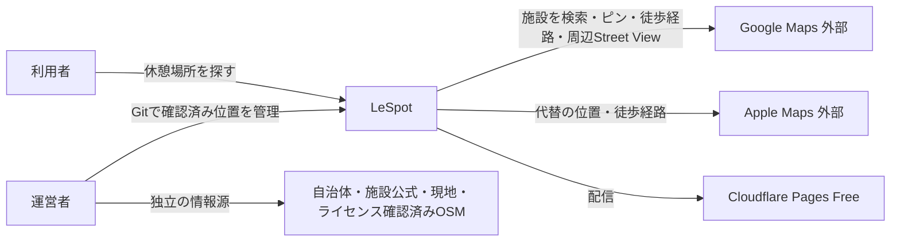
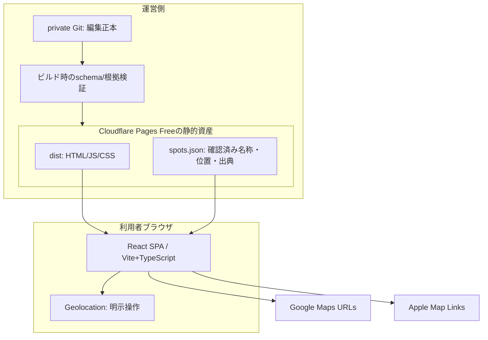
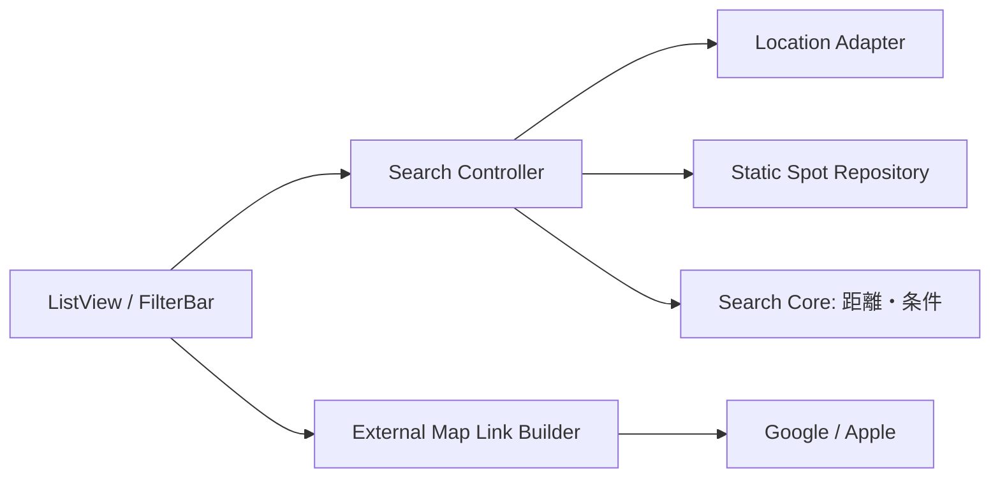
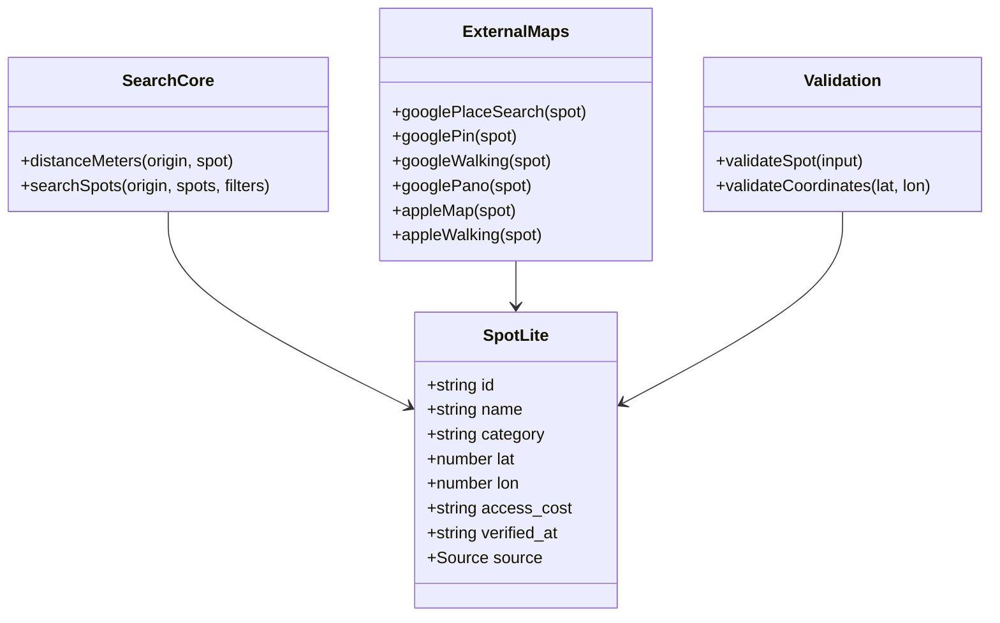

# LeSpot C4モデル — 写真なし・無料優先アーキテクチャ v1.2

2026-10-11、ユーザー指示による改訂。**MVP0の正本は[FREE_MVP_STRATEGY.md](FREE_MVP_STRATEGY.md)**。以前のD1・Worker API・R2画像ゲート構成は初期公開の推奨から除外。C4でいうContainerはDockerと同義ではない。

## C1 Context

LeSpotはGoogleのレビューや画像を保存・転載しない。Google側の施設検索結果が正しい対象となる保証はしない。

## C2 Containers

**この段階には存在しないコンテナ：** 公開read API、D1、R2、画像加工、ログイン、投稿基盤。静的サイトと公開データは同じ配信系。データ修正はGit変更→再ビルド→再配信が必要。

## C3 Components (Web SPAのみ)

UIから外部アプリへ移動する前に位置/住所の妥当性を検証。GPSはアプリメモリに保持し、LeSpotや外部地図へ出発地点として送らない。ドメイン計算はReactから独立した純粋TypeScriptで実装する。

## C4 Code Contracts

テスト：正確な座標/緯度経度、距離の境界、同距離ID順、無料と不明、Googleの同名誤解決、Street Viewの最寄りパノラマ、URLエンコード、位置情報拒否。

## 拡張判断

| 順序 | 追加条件 | 技術 |
| --- | --- | --- |
| MVP0 | 一覧・位置・外部地図で検証できる | React/Vite + Pages Free + 静的JSON + Google/Apple URL |
| UX改善 | 一覧だけでは周辺を認識しにくい | Leaflet＋地理院タイル。施設の情報は独立データ |
| 情報拡張 | 電源等の厳密条件検索の需要と根拠が確保された | 施設フィールドの追加と確認期限管理 |
| 運用拡張 | 更新頻度・地域数が静的配信の限界に達した | D1 Free / Worker APIを費用再評価後に導入 |

写真の運用はどのフェーズでも既定復活しない。Cloudflareの無料枠、Google Maps URLsのAPIキー不要性、自治体・OSMの権利は[FREE_MVP_STRATEGY.md](FREE_MVP_STRATEGY.md)にまとめる。

**状態：設計のみ。** ブラウザ実装・実施設の確認・配信/監視は未実施。
