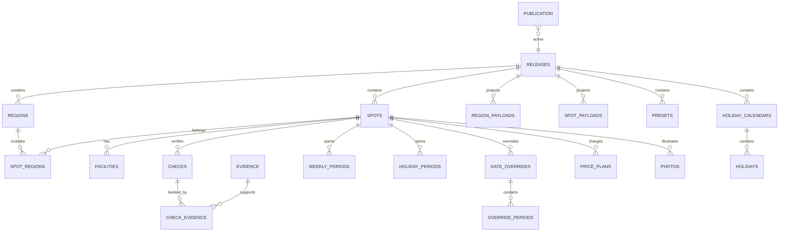

> **2026-10-11の方針更新：** この文書には写真・D1・Worker APIを含む旧MVPの内容が残る。**現在のMVP0では写真運用、D1/R2、公開API、LeSpot内地図を必須にしない。** 現行の初期公開仕様は[FREE_MVP_STRATEGY.md](FREE_MVP_STRATEGY.md)、C4構成は[ARCHITECTURE.md](ARCHITECTURE.md)が優先。以下は拡張時の履歴資料であり、写真を後から実装する許可ではない。

# データモデル・データ辞書 v1.0

状態：暫定推奨設計。アプリDB・マイグレーションは未作成。編集正本はGit JSON、D1はその派生読取モデル。検索規則は `DETAILED_DESIGN.md`、公開DTOは `API.md`。

## 1. 共通規則

IDは小文字UUID v4（地域・プリセット・コードを除く）。日時はRFC 3339 UTC、必ず `Z`、日付は `YYYY-MM-DD`、施設の時刻はローカル分数。金額はJPYの整数円・税込。座標はWGS84の緯度経度、APIは `lat` / `lon` を明示し、bboxだけ `[west,south,east,north]` 順とする。緯度[-90,90]、経度[-180,180]、NaN/Infinity禁止。入力精度と実際の位置精度を混同しない。

SQLite型はTEXT/INTEGER/REALを使用。booleanはINTEGERの0/1。`?` はNULL可、それ以外はNOT NULL。空文字、空配列、0、NULLは別物。全外部キーは有効化し、公開版間の誤参照を禁止する。

以下で **R** と記した表は `release_id TEXT NOT NULL REFERENCES releases(id)` を持ち、PK・UK・FKにrelease_idを含む。業務IDが同じでも異なる版は別行。readyになった版の業務行は更新禁止。新しい版を作る。データ削除は公開版切替と保持版GCに分ける。

## 2. ER図

図は業務上の関係を示す。実際の複合キーは以下の辞書が正本。

## 3. 公開版管理

### releases

| 列 | 型・制約 | 意味 |
| --- | --- | --- |
| id | TEXT PK | release UUID |
| source_git_sha | TEXT、40桁hex | 編集正本のCommit |
| schema_version | INTEGER、初期1 | 公開契約の版 |
| state | TEXT、staging/ready/failed | publishedはここに持たずpublication参照で判断 |
| content_sha256 | TEXT、64桁hex | 正規化入力全体のcanonical hash |
| created_at | TEXT | 生成日時 |
| validated_at | TEXT? | 検証完了日時。readyなら必須 |
| created_by | TEXT | 運営者ID。公開DTOには含めない |
| validation_summary | TEXT | 件数・ハッシュ・検証結果のJSON、最大32KB |

### publication

`id INTEGER PK CHECK(id=1)`、`active_release_id TEXT? FK releases(id)`、`revision INTEGER >=0`、`switched_at TEXT?`、`switched_by TEXT?`。初期はactive=NULL/revision=0。切替はexpected_revisionを比較した1つのUPDATE。rollbackでもrevisionを増やす。既存の更新を無視したforce相当の公開をしない。

### region_payloads / spot_payloads（R）

`region_payloads` はPK `(release_id,region_id)`、同版regionsへのFK、`payload_json TEXT`、`sha256 TEXT`、`byte_length INTEGER`、`gzip_byte_length INTEGER`、`spot_count INTEGER`。

`spot_payloads` はPK `(release_id,spot_id)`、同版spotsへのFK、`payload_json TEXT`、`sha256 TEXT`、`byte_length INTEGER`。

JSONは公開allowlistから生成し、JSON validity、件数、checksumを検証する。地域JSONはUTF-8未圧縮1,500,000 bytes・gzip350KB・500件以下、詳細は64KB以下。D1の1行2,000,000 bytes制限より余裕を持たせる。payloadを編集正本にしない。[公式制約：RESEARCH_AND_COSTS.mdのSRC-08]

## 4. 地域・プリセット

### regions（R）

PK `(release_id,id)`。`id TEXT` は `[a-z0-9-]{1,64}`、`name TEXT(1..80)`、`timezone TEXT`（IANA、初期Asia/Tokyo）、`center_lat/center_lon REAL`、`west/south/east/north REAL`、`enabled INTEGER`。west<east、south<north、中心はbbox内。MVPは日付変更線を跨ぐbboxを許可しない。

初期地域IDの推奨は `nagoya-central`。周辺範囲は運営上の矩形であり行政区境界ではない。具体的境界はデータ収集WUで確定する。範囲外スポットを収集しながら設定を黙って拡張しない。

### presets（R）

PK `(release_id,id)`。`id TEXT`（初期sakae/hisaya-odori/yabacho）、`label TEXT(1..40)`、`lat/lon REAL`、`zoom INTEGER(12..18)`、`sort_order INTEGER`。地点座標の公式・現地確認記録は編集正本のsourceメタデータに残す。架空座標を正式な駅入口と表示しない。

### spot_regions（R）

PK `(release_id,spot_id,region_id)`。それぞれ同版FK。1スポットは最低1地域。`spots.home_region_id` を必ず含める。隣接地域へ同じスポットを含める場合もIDは共通。所属数は最大8。地域分割・境界重複時も全体件数はIDで数える。

## 5. スポット

### spots（R）

PK `(release_id,id)`、home_region_idは同版regionsへFK。下記の文字数はUnicodeコードポイントで検証し、byte制限は別途payload全体で判定する。

| 列 | 型・許容値 | 入力・表示規則 |
| --- | --- | --- |
| id | TEXT | 休憩区画の安定ID。名称変更でも再採番しない |
| home_region_id | TEXT | 主所属地域 |
| venue_key | TEXT?、最大80 | 同じ建物・施設を束ねる任意キー。設備継承には使わない |
| name | TEXT、1..120 | 施設名だけでなく区画が分かる名称 |
| description | TEXT、0..1000 | 運営が作成した平文 |
| category_code | TEXT | 後述の17コード |
| lat / lon | REAL | 代表座席位置。施設中心で曖昧なら注記 |
| location_accuracy_m | INTEGER?、1..1000 | 運営が判断した位置精度。ユーザーGPS精度とは別 |
| address | TEXT、1..300 | 表示用住所 |
| floor | TEXT?、最大40 | B1、4F等 |
| entrance_note | TEXT?、最大500 | 地上入口、階段、改札内等の説明 |
| access_note | TEXT、1..1000 | 利用資格、購入義務、会員・予約、休憩区画のルール |
| environment | TEXT | indoor/outdoor/mixed/unknown |
| entry_cost_type | TEXT | free/paid/unknown。無料部分と有料部分は原則別スポット |
| entry_min_jpy | INTEGER?、0..1000000 | 公開器による派生値。直接編集しない |
| price_note | TEXT、0..1000 | 最低料金に含まれるもの、追加料金、変動条件 |
| stay_limit_kind | TEXT | limited/unlimited/unknown |
| max_stay_minutes | INTEGER?、1..1440 | limitedの時だけ必須。それ以外はNULL |
| stay_note | TEXT、0..500 | 混雑時制限等。確認なしにunlimitedにしない |
| quietness | TEXT | quiet/normal/busy/unknown |
| quietness_note | TEXT、0..500 | 主観・観察条件。既知値なら必須 |
| quietness_observed_at | TEXT? | 観察日時。既知値なら必須 |
| hours_mode | TEXT | regular/always/irregular/unknown |
| holiday_policy | TEXT | same/special/unknown |
| hours_note | TEXT、0..1000 | 最終入場・施設全体との相違等 |
| publication_state | TEXT | draft/published/suspended/retired |
| operation_state | TEXT | operating/temporarily_closed/permanently_closed/unknown |
| closure_note | TEXT、0..500 | 休業理由・再開見込。不明は断定しない |
| is_fixture | INTEGER | 1なら本番公開禁止 |
| created_at / updated_at | TEXT | データ編集時刻。確認時刻ではない |

`entry_min_jpy` は、price checkがconfirmedで、適格な `price_plans` がある場合にその最小値から生成。paidなら1円以上、freeなら0円かつ価格・利用条件の根拠が必要。変動価格しかない場合はNULL。チェック期限切れ時のAPI表示・検索扱いは実行時に変わる。

`hours_mode=always` は休憩区画の通常24時間利用を確認した場合のみ。建物が24時間営業でも区画が閉まる場合はregularとする。`operation_state=unknown` は検索候補へ出さず、公開審査で解消する。

### カテゴリコード

`park` 公園 / `bench` ベンチ / `public_facility` 公共施設 / `library` 図書館 / `station_lounge` 駅待合 / `commercial_rest` 商業施設休憩 / `underground_rest` 地下街休憩 / `food_court` フードコート / `cafe` カフェ・喫茶店 / `fast_food` ファストフード / `family_restaurant` ファミレス / `internet_cafe` ネット・漫画喫茶 / `coworking` コワーキング / `bath_sauna` 温浴・サウナ / `nap_facility` 仮眠施設 / `capsule_hotel` カプセルホテル / `hotel_dayuse` ホテルデイユース。

コードは安定値。表示ラベル変更とコード変更は区別する。施設を複数カテゴリで多重登録せず、主カテゴリ1つと独立した設備を使う。

## 6. 設備・条件

### facilities（R）

PK `(release_id,spot_id,code)`。同版spotsへFK。`value TEXT` はyes/no/conditional/unknown、`note TEXT(0..500)`。conditionalでは利用条件のnote必須。行がないコードはunknownとして公開DTOを補完する。

13コード：`chair`、`bench`、`sofa`、`toilet`、`power`、`wifi`、`cooling`、`heating`、`eating_allowed`、`drinking_allowed`、`smoking_area`、`nap_allowed`、`lie_down_allowed`。

椅子等は「存在」、飲食・仮眠・横臥は「その区画で許可されていること」を表す。powerは利用者用、wifiは利用者が使えるネットワーク。空席、回線速度、動作中の冷暖房は保証しない。喫煙所と座席の喫煙可否を同一視しない。

飲食のconditional例は「購入した飲食物のみ」。見えているコンセント、寝ている利用者、施設一般の設備だけを肯定根拠にしない。

## 7. 根拠・確認・鮮度

### evidence（R）

PK `(release_id,id)`。`kind` はofficial_site/official_open_data/field_observation/operator_contact、`publisher TEXT(1..120)`、`public_url TEXT?`、`retrieved_at TEXT`、`license_code TEXT`、`terms_url TEXT?`、`summary TEXT(0..500)`、`private_proof_ref TEXT?`。public_urlとterms_urlはhttpsのみ。現地確認・電話確認はURLなしでも可。要約は転載ではなく確認した事項を自分の文で記載する。

権利不明の全文や写真を保存しない。private_proof_refは機密保管先の識別子に留め、許可メール本文・個人の連絡先はGitへ入れない。公開DTOにはこの列を含めない。

### checks（R）

PK `(release_id,spot_id,field_key)`。`status` はconfirmed/unverified/disputed、`verified_at TEXT?`、`valid_until TEXT?`、`note TEXT(0..500)`。confirmedではverified_at・valid_untilと根拠1件以上が必須。unverified/disputedは厳密検索に一致しない。valid_untilは半開区間の終端で、`now < valid_until` の時だけfresh。

field_keyは `identity`、`location`、`access`、`environment`、`price`、`stay`、`hours`、`quietness`、`facility:{13コード}`、`hours_exception:YYYY-MM-DD`。missing checkはunverified扱い。known値にcheckが欠けたpublishedレコードは公開器で拒否する。

初期TTL上限：identity=180日、location/environment/座席・一般設備=90日、access/price/stay/hours/飲食・仮眠・横臥許可/quietness=30日。hours_exceptionは30日と当該例外日翌日0時の早い方。資料に明示された有効期限がより短ければそれを使う。未検証のままTTLだけ延ばさない。全公開レコードの初回確認30日要件はTTLとは別。

### check_evidence（R）

PK `(release_id,spot_id,field_key,evidence_id)`。checksとevidenceへ同版FK。最大5根拠/チェック。出典を変えてもverified_atを自動更新しない。複数情報の矛盾はdisputedにし、古い肯定を残して条件一致させない。

## 8. 営業時間

### weekly_periods（R）

PK `(release_id,spot_id,iso_weekday,seq)`。iso_weekday=1（月）..7（日）、seq=0..7、`start_min INTEGER(0..1439)`、`end_min INTEGER(1..2880)`。start<end、end-start<=1440。時刻は開始曜日の00:00から数える。月22:00〜火02:00はweekday=1,start=1320,end=1560。重複期間は禁止、接続区間は生成時に結合可。

regularのみ使用。alwaysは通常毎日[0,1440)を生成する。irregular/unknownは通常時間を計算しない。weekly行のない通常曜日はclosed。ただし前日からの日またぎ期間を必ず評価する。

### holiday_periods（R）

PK `(release_id,spot_id,seq)`。start_min/end_minは0..1440内の暦日区間、start<end。holiday_policy=specialのみ。0行は祝日終日閉鎖。祝日前夜からの持越しも祝日ルールで置換する。sameは通常どおり、unknownは祝日判定をunknownにする。

### date_overrides / override_periods（R）

`date_overrides` PK `(release_id,spot_id,date)`、`state` open/closed/unknown、`note TEXT`、対応するhours_exception check必須。

`override_periods` PK `(release_id,spot_id,date,seq)`、同版date_overridesへFK、start_min/end_minは[0,1440]内、start<end。state=openでは1〜8区間、closed/unknownでは0区間。例外は**暦日全体**を置換する。前日からの営業もその日に入る部分を置き換える。営業日単位で休むなら持越し先の日も必要に応じて登録する。

### holiday_calendars / holidays（R）

calendar PK `(release_id,country_code)`、初期JP、`coverage_start/coverage_end DATE`、`source_url TEXT`、`checked_at TEXT`。holidays PK `(release_id,country_code,date)`、`name TEXT`、calendarへFK。範囲内で行のない日は非祝日、範囲外は不明。祝日を外部APIへ毎回問い合わせず、公式CSVから検証済み版を生成する。

## 9. 料金

### price_plans（R）

PK `(release_id,spot_id,id)`。`label TEXT(1..120)`、`entry_min_jpy INTEGER? (0..1000000)`、`tax_included INTEGER`、`applicability TEXT`（all_hours_general/conditional/dynamic/unknown）、`details TEXT(0..1000)`、`valid_from DATE?`、`valid_to DATE?`、`sort_order INTEGER`。

entry_min_jpyは一般成人が予約・会員割引なしで利用を開始する際の必須支出を全て含む。入場料、最低注文、必要な登録料等を確認できなければNULL。時間加算、延長料、休日料金、会員条件はdetailsへ記載する。

厳密予算検索に使用できるのはall_hours_general、税込、現在有効、price check freshのプランのみ。条件付き・動的料金は表示専用。未来の予約料金や会員価格を最低料金の派生値にしない。valid_toはその施設タイムゾーンの当日末まで有効。日またぎ料金・総滞在料金の計算器はMVPでは作らない。

## 10. 写真

### photos（R）

PK `(release_id,id)`、spot_idは同版FK。`rights_status` approved/pending/revoked、`license_code` owned/permission/CC-BY-4.0/CC0、`credit TEXT(1..300)`、`source_url TEXT?`、`license_url TEXT?`、`permission_ref TEXT?`、`captured_at TEXT?`、`alt TEXT(1..200)`、`caption TEXT(0..300)`、`sort_order INTEGER`、`thumb_key/detail_key TEXT`、`thumb_sha256/detail_sha256 TEXT`、`thumb_width/thumb_height/detail_width/detail_height INTEGER`、`thumb_bytes/detail_bytes INTEGER`。

approved以外を公開しない。撮影日時が不明ならNULLのまま「撮影日不明」。提供者指定のattributionを保持する。permission_refとR2内部キーは公開DTOから除外。WebPのthumb最大480px/60KB、detail最大1280px/240KB、双方EXIF・GPS除去、縦横比維持。実施設の生成画像・無許可の画像転載は本番禁止。原本はprivate保管で、このAPIから配信しない。

## 11. インデックス・整合性

各複合PKに加え、spots `(release_id,home_region_id,publication_state,operation_state)`、spot_regions `(release_id,region_id,spot_id)`、photos `(release_id,spot_id,rights_status,sort_order)`、checks `(release_id,status,valid_until)`、releases `(source_git_sha,content_sha256)` を作る。後者は同一ソース再実行の重複検出に用いる。

緯度経度の地理演算用indexはMVPでは不要。距離は公開地域データを用いてブラウザで計算する。APIはactive release、主キー、payloadを使い、全施設のJOINを毎リクエスト実行しない。

公開検証はFK、enum、文字・byte長、known/check対応、根拠数、写真権利、座席または仮眠設備の根拠、無料/料金矛盾、時間重複、同一施設内の区画混同、fixture混入、公開DTOの秘密情報、画像存在・checksum、地域境界を検査する。地理座標が近いだけで重複を自動削除しない。

## 12. 変更・保持・将来

マイグレーションは番号付きで追加し適用済みファイルを改変しない。DTO非互換はschema_versionを上げ、クライアントと公開器の互換性を確認する。保持版はactiveと直近5版を基本とし、権利取り下げ画像は過去版にも再公開させない運用を必須にする。

users/reviews/favorites/occupancy/submissionsテーブルはMVPに作らない。将来追加時は公開済みスポットの安定IDに関連付け、位置履歴や認証を別要件として扱う。
