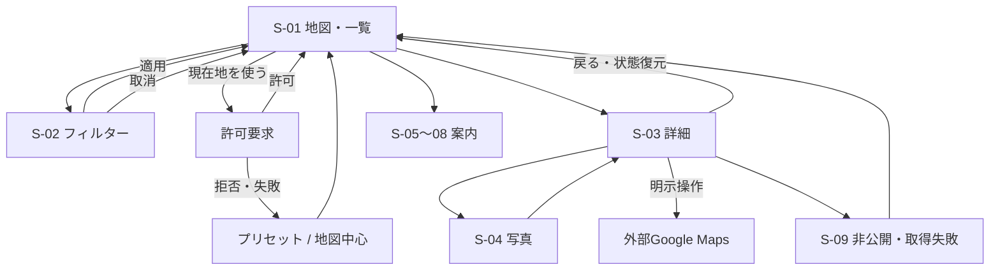

> **2026-10-11の方針更新：** この文書には写真・D1・Worker APIを含む旧MVPの内容が残る。**現在のMVP0では写真運用、D1/R2、公開API、LeSpot内地図を必須にしない。** 現行の初期公開仕様は[FREE_MVP_STRATEGY.md](FREE_MVP_STRATEGY.md)、C4構成は[ARCHITECTURE.md](ARCHITECTURE.md)が優先。以下は拡張時の履歴資料であり、写真を後から実装する許可ではない。

# 画面・UX設計 v1.0

目的は「休憩条件で候補を探し、条件を理解して外部経路へ進む」。以下は暫定ワイヤーフレームであり、承認済みビジュアルデザインや実装済み画面ではない。例の施設名・数値は架空。ブランド配色の承認を待たずに構造・状態の設計を進める。

## 1. 画面一覧

| ID | URL / 種類 | 主な要素 |
| --- | --- | --- |
| S-01 | / | 地域・現在地、主要フィルター、地図/一覧、状態表示 |
| S-02 | S-01内のfilter dialog | draft条件、適用、キャンセル、全解除 |
| S-03 | /spots/{id} | 写真、利用条件、料金、営業、設備、出典、外部経路 |
| S-04 | S-03内のphoto dialog | 拡大写真、説明、出典、閉じる |
| S-05 | /about | 提供地域、情報の限界、運営連絡先 |
| S-06 | /privacy | 現在地、タイル・外部サービスへの送信、基盤ログ |
| S-07 | /terms | 利用条件、免責の範囲、施設ルール優先 |
| S-08 | /credits | 地図・公開データ・写真・OSSの帰属表示 |
| S-09 | error/404/410状態 | 再試行、検索へ戻る、非公開メッセージ |

専用管理画面は作らず、運営手順をGit/CLIで提供する。プライバシー・規約本文は運営者と連絡先確定後に公開レビューする。

## 2. 画面遷移



## 3. スマートフォンのワイヤーフレーム

目安は幅390CSS px、320pxでも横スクロールなし。地図操作だけに依存せず、固定タブで一覧へ切り替えられる構成。

```text
┌─────────────────────────┐
│ LeSpot       休憩場所を探す │
│ [栄周辺 ▼] [現在地を使う]   │
│ [無料] [屋内] [電源] [条件] │
│ 栄を基準・直線1km  [変更]   │
│ [地図]              [一覧] │
├─────────────────────────┤
│                         │
│       地図・候補ピン      │
│     [この周辺で探す]      │
│                         │
│ [現在地]          [+][-]  │
│         出典：地理院タイル │
├─────────────────────────┤
│ 12件 / 直線距離の近い順    │
│ 架空：公園の休憩ベンチ     │
│ 約200m  無料  屋外        │
│ ベンチあり / 写真未登録    │
│ 最終確認 2026-10-01       │
│                [詳細を見る]│
└─────────────────────────┘
```

地図タブでは選択カード1件、一覧タブでは20件ずつのカードと「さらに表示」。ドラッグ可能なbottom sheetを必須にせず、手の震え・読上げ・キーボードでも同じ機能に到達させる。ピンの出典表示を固定CTAやノッチで覆わない。

## 4. PCのワイヤーフレーム

幅1024CSS px以上で2カラム。640〜1023は余裕のある単一カラム+地図/一覧切替。

```text
┌─────────────────────────────────────────────────────┐
│ LeSpot [地域 ▼] [現在地を使う] [無料] [屋内] [条件…]   │
├──────────────────────┬──────────────────────────────┤
│ 基準:栄 / 直線1km     │                              │
│ 12件・近い順          │          地図                │
│ [候補カード]          │      選択ピン                │
│ [候補カード]          │                              │
│ [候補カード]          │  [この周辺で探す]             │
│ [さらに表示]          │                 地図出典     │
└──────────────────────┴──────────────────────────────┘
```

一覧は幅360〜420px、地図は残り。外側ページと一覧の二重スクロールが不自然にならないよう高さを設計し、100dvhやsafe-areaを実機確認する。Tab順は見出し→地域→主要条件→結果一覧→地図操作→案内。

## 5. フィルター

主操作は無料、屋内、電源、条件全体。省略表示のチップでも現在適用中か読める。条件ボタンに適用数を表示する。

```text
┌─────────────────────────┐
│ 条件で絞り込む       [閉じる]│
│ 距離  ○300m ○500m ●1km … │
│ 料金  ●すべて ○無料 ○有料 │
│ 最低利用料金の上限 [指定なし]│
│ ※滞在総額ではありません   │
│ 屋内外 [屋内] [屋外] [混在]│
│ 座席 [椅子] [ベンチ] [ソファ]│
│ 設備 [電源] [Wi-Fi] [トイレ]│
│ [冷房] [暖房] [飲食可] …  │
│ □条件付きの設備も含める   │
│ □営業時間上、現在利用可能 │
│ 今から滞在 [指定なし / 30分…]│
│ 夜間 [指定なし / 深夜 / 本日24h]│
│ □静か（観察時点） □写真あり│
│ [全解除]            [適用]│
└─────────────────────────┘
```

カテゴリ等の詳細条件は折りたたみ可だが選択中条件を隠さない。座席内OR、設備間ANDを補助文で示す。条件付きの設備は購入・時間・場所の制約がある候補と明示。現在利用可能と空席ありを同じラベルにしない。

最低料金上限の0は無料区分と自動同義にしない。派生値0の適格性はドメイン規則に従う。深夜の対象日（例：10月12日0〜5時）を必ず表示する。min_stayは「今からN分、営業時間と滞在制限を確認できる場所」と説明する。

適用はdraft→applied。閉じる、Escape、戻るはdraft破棄。全解除はdraftだけを初期化し、適用するまで結果を変えない。

## 6. 詳細画面

```text
┌─────────────────────────┐
│ [検索に戻る]              │
│ 架空：商業施設4F休憩席     │
│ 無料 / 屋内 / 約300m      │
│ [権利確認済み写真 / 未登録] │
│ 営業時間上は利用可能       │
│ 空席・臨時変更は未確認     │
│ 利用条件：購入不要等       │
│ 料金：無料／最低料金の根拠 │
│ 滞在：制限不明なら不明     │
│ 本日の時間・通常・例外     │
│ 設備：あり／なし／条件／不明│
│ 階・入口・アクセス説明     │
│ 項目別確認日・公式出典     │
│ 写真出典・運営への連絡     │
│ [外部地図で経路を確認]     │
└─────────────────────────┘
```

情報の順番は利用可否・料金・アクセスを優先。料金に条件があれば価格と同じ視覚範囲に表示する。全設備に「あり」を並べずunknownも読み取れるようにする。確認日は写真、営業時間、設備で異なり得るため、総合の「更新日」だけで済ませない。

現在地未取得では距離を表示せず、共有presetに基づく場合はその名称を付ける。写真の掲載自体で空席を推定しない。temporarily_closedなら先頭に休業表示し、経路CTAを無効化する。

## 7. 状態別のコピーと回復

| 状態 | 表示例 | 操作 |
| --- | --- | --- |
| 初回 | 現在地を使うか、地域を選んで探せます | 現在地、地域選択 |
| 位置拒否 | 現在地は使わず、地域や地図の中心から探せます | プリセット、中心指定 |
| 精度不足 | 位置がずれている可能性があります（精度の目安○m） | 地図で選ぶ、再取得 |
| 0件 | この条件に合う確認済みスポットはありません | 条件を個別解除、距離変更 |
| 地域未対応 | この周辺はまだ情報を整備していません | 対応地域を見る |
| 一部失敗 | 一部地域の情報を取得できません。表示件数は一部です | 再試行 |
| 地図失敗 | 地図を読み込めません。一覧から探せます | 一覧、地図再試行 |
| データ失敗 | スポット情報を取得できませんでした | 再試行。架空候補を見せない |
| 更新中 | データが更新されたため再取得しています | 1回再試行、失敗なら手動 |
| 情報期限切れ | 前回確認から時間が経っています。条件は要確認です | 公式情報へ |
| 長時間オフライン | 最新情報を確認できません。営業時間の絞込を停止しています | 再接続・再試行 |
| 写真なし | 写真は未登録です | 他の詳細は表示 |
| 写真失敗 | 写真を読み込めませんでした | 再試行、閉じる |
| 非公開・閉鎖 | このスポットは現在案内できません | 検索に戻る |

色だけで状態を伝えない。ネットワーク不通の0件を「この周辺にはありません」と表示しない。

## 8. アクセシビリティ

WCAG 2.2 AAを目標とし、地図以外の一覧を機能的な代替として維持する。[SRC-14]

本文16CSS px以上を基本、行間1.5、通常文字のコントラスト4.5:1以上、大文字3:1以上。ボタンは原則44×44CSS px以上を製品目標とし、WCAGの最小ターゲット基準と混同しない。200%文字拡大と320CSS px幅で欠け・操作不能なし。

dialogは見出しと説明を関連付け、開くと内部へfocus、閉じると元のボタンへ戻す。背景をinertにしfocus trapとEscapeを確認。aria-live=politeで検索結果件数を通知し、各ピンの全更新を読み上げさせない。

ピンには名称・選択状態を与え、タブ数が多すぎる場合は地図へのショートカットと同等の一覧選択を提供する。キーボードで地図拡大・中心移動ができ、ドラッグが唯一の操作にならない。reduced-motionではpan・スクロール・パネルの移動を抑える。

画像には施設区画を説明するalt、装飾画像は空alt。写真captionとクレジットを読めるようにする。自動a11yツールの合格だけで適合を宣言しない。

## 9. 地図表現と負荷

地理院の淡色地図を初期候補、標準地図への切替を用意する。公式tile定義に従うzoomで読み込み、初期表示は15〜16を現地UXで選ぶ。最大native zoom18、地図データの過拡大を実測精度と誤認させない。[SRC-01]

休憩ピンは背景と区別できる輪郭・選択ラベルを付ける。無料・有料は文字でも示す。ピンの重なりは件数集約し、最大zoomでは候補一覧を開く。選択カード・bottom操作領域・safe-areaが出典を隠さないことを実機で検証する。

## 10. レビュー・検証

画面設計承認と実装確認を分ける。低解像度ワイヤーのレビューでは情報順と操作、実装後は実際の日本語地図、屋外での可読性、地下の位置失敗、スマートフォン戻る操作、Windowsのキーボードを確認する。テスト課題・数値は `TEST_PLAN.md`。現時点で実画面・現地UXの確認は未実施。
